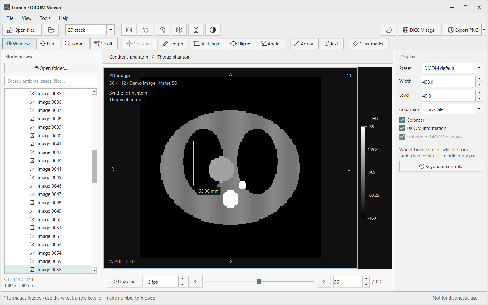
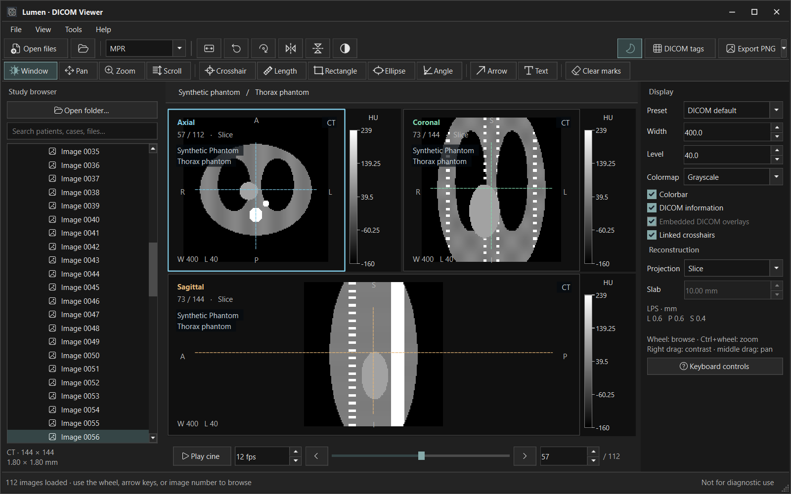
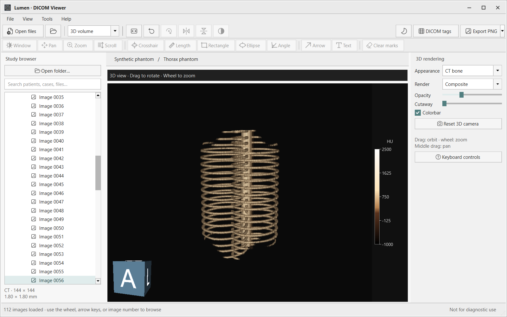

# Lumen DICOM Viewer

A local Windows desktop viewer built with Python, Qt (PySide6), NumPy/SciPy, pydicom, and VTK. It includes native 3D volume rendering and linked patient-coordinate MPR. All processing happens on this computer; there are no servers, accounts, or uploads. Original DICOM files are opened read only.

**Status:** development release 0.3.0, including themes, editable icons, colorbars and NIfTI support. Tested on Windows with generated fixtures and a supplied 299-slice MRI series. Portable builds include the native NIfTI converter and do not require Python to be installed.

## Windows installer

Published downloads are listed on the **[GitHub Releases page](https://github.com/farivarlab/DICOM_Viewer/releases)**. In a release's **Assets**, choose `Lumen-<version>-Setup-win64.exe` for the installer, or the portable EXE/ZIP if you prefer to run without installation. Installers appear there after a release is published; building locally does not upload them.

The installer includes Python, Qt/VTK, image codecs and the NIfTI converter. It installs for your Windows account under `%LOCALAPPDATA%\Programs\Lumen`, without an administrator prompt. It creates Start menu entries and offers an optional desktop shortcut. The installer works offline and does not take over DICOM/NIfTI file associations.

To update, close Lumen and run the newer installer. It reuses the installation folder and preserves your preferences and custom `logo.svg`. To remove it, use **Windows Settings → Apps → Installed apps → Lumen DICOM Viewer → Uninstall**, or **Uninstall Lumen** in its Start menu folder. The uninstaller removes the installed program, shortcuts, its preferences and generated icon cache. It leaves image files and exports alone, including files you put inside the installation folder.

To build the installer on Windows, install [Inno Setup 6](https://jrsoftware.org/isinfo.php) and run:

```powershell
.\Build-Installer.ps1
```

This first builds the current portable release, then creates `dist/Lumen-0.3.0-Setup-win64.exe` and adds it to `dist/SHA256SUMS.txt`. To compile the installer again without rebuilding the runtime, use `-SkipPortableBuild`; the build checks that its payload still matches the current runtime sources. Use `-CompilerPath 'C:\Path\To\ISCC.exe'` for a nonstandard Inno Setup location. The uninstaller is generated and installed by Setup; it is not a separate download.

## Screenshots

These screenshots use the built-in synthetic thorax phantom; no patient data is shown. Not For Diagnostic Use.

**2D viewing · light theme.** Slice browsing, distance measurement, image annotations and a calibrated colorbar.



**Multiplanar reconstruction · dark theme.** Linked axial, coronal and sagittal views with crosshairs.



**3D volume rendering.** Native VTK rendering with the CT bone preset, opacity and cutaway controls, and an orientation cube.



## Run from source

The development environment in this workspace is already prepared. Double-click **`Lumen DICOM Viewer.lnk`** to launch without a terminal. `Run-Lumen.cmd` remains available, or run:

```powershell
.\.venv\Scripts\python.exe -m lumen
.\.venv\Scripts\python.exe -m lumen --demo
.\.venv\Scripts\python.exe -m lumen 'C:\Scans\Study'
```

For a fresh checkout, use 64-bit Python 3.12:

```powershell
py -3.12 -m venv .venv
.\.venv\Scripts\python.exe -m pip install -r requirements.txt
.\.venv\Scripts\python.exe -m lumen
```

## Included

| Area | Features |
| --- | --- |
| Import | DICOM files, scalar NIfTI `.nii` / `.nii.gz` (2D, 3D, 4D), recursive folders, DICOMDIR references, ZIP archives, drag and drop; patient → case/study → series → file/frame browser with search, scrolling and paged expansion; cancellable background indexing and decoding |
| 2D | Default view when opening a series or file; centered first image; linked browser selection; wheel/slider, previous/next, direct image-number and keyboard navigation; per-file/per-frame window and calibration defaults; window/level and presets; auto contrast; zoom, pan, rotate, flip; MONOCHROME1 inversion; RGB and palette-color display |
| Tools | Distance, three-point angle, rectangular and elliptical ROI with area/mean/SD/min/max, arrows, text; density probing; undo last mark and clear marks |
| Colormaps | Grayscale, bone, hot iron, viridis, magma, cool, rainbow; invert any map; labeled colorbars for 2D/MPR and the actual 3D transfer colors |
| Playback | Cine loop, 1–60 fps, single-frame and multi-frame sequences |
| MPR | Axial, coronal, sagittal views in patient LPS coordinates; linked crosshairs; MIP, MinIP, average slabs; physical spacing; resampling of oblique acquisitions and uniformly tilted stacks |
| 3D | VTK adaptive GPU/CPU volume mapper; orbit/pan/zoom; CT tissue/bone/lung and scalar transfer presets; opacity; composite/MIP/MinIP; posterior cutaway; anatomical orientation cube |
| DICOM annotations | Current file's patient name/ID, birth date/age/sex, study/series, institution, date/time, acquisition settings and accession in the image frame when present; stored 60xx Overlay Data with origin and frame handling; separate visibility controls |
| Metadata/export | Searchable read-only DICOM tags or NIfTI header pane, hidden by default and toggled with Ctrl+I; metadata CSV; annotated/unannotated PNG export; NIfTI series/volume export; clipboard; actual VTK framebuffer capture in the 3D-only layout |
| Interface | RAWDATA_Viewer's modern/classic light and dark palettes, typography and square window controls; dark image panes; Microsoft Fluent System Icons (MIT) for common commands and original specialist-tool glyphs; maximized startup with a small loading splash; one editable SVG for application identity |

Measurements use millimeters only when pixel spacing is present; otherwise they use pixels. Areas count included pixel centers. User annotations remain in memory, belong to their view/slice/projection, and are cleared when changing series.

Choose **View → Appearance → Modern light / Modern dark / Classic light / Classic dark**. These are independent local copies of RAWDATA_Viewer's JSON palettes, QSS styles and window controls; this viewer does not depend on that project's installation. Modern uses Segoe UI and Classic uses Tahoma. Modern light is the initial default. Existing light/dark preferences migrate to the matching modern preset. The moon button switches light/dark within the current family. Preferences stay in `.lumen-settings.ini`, without registry changes. Switching themes leaves image contrast, colormaps, and exports unchanged.

Edit **[logo.svg](logo.svg)** in the project root to change the application icon. Restart or choose **View → Appearance → Reload appearance assets** (**Ctrl+Shift+R**) to update the window, title bar, taskbar identity, floating metadata pane, open dialogs, About logo, splash and matching project-local shortcuts. **Open logo folder** opens its location. Windows ICOs are generated at multiple sizes under `.cache/icons`; changed SVG content gets a new icon filename so Explorer can refresh its cached image. The bundled `lumen/resources/lumen.svg` is the fallback for missing/invalid custom artwork.

The Windows launch shortcut is **`Lumen DICOM Viewer.lnk`**. It points directly to `.venv/Scripts/pythonw.exe -m lumen` with this project as its working directory. After moving the project, recreate the shortcut with **`Create-Shortcut.ps1`**. Its icon refresh preserves existing launch options. Editable theme files live in `lumen/resources/themes`; **Open theme folder** and **Reload appearance assets** use the same workflow as RAWDATA_Viewer. Changes to these assets do not rebuild the existing EXE.

Lumen starts maximized, keeping the Windows title bar and taskbar visible. **F11** enters full screen; pressing it again returns to the maximized window. A small splash appears before the imaging libraries load and closes when the main window is ready, without a minimum display delay. The splash follows the selected light/dark theme.

The study browser shows the DICOM series number before the modality and description, for example **12 · MR · NoiseCovariance**, and orders series numerically within each study. Image and file counts are in the tooltip. Missing series numbers are left out; the viewer does not invent them. Series numbers are searchable.

Common command icons use Microsoft's [Fluent System Icons](https://github.com/microsoft/fluentui-system-icons), distributed under the [MIT license](https://github.com/microsoft/fluentui-system-icons/blob/main/LICENSE). The subset and its license/copyright notices are included under `lumen/resources/fluent/`; each original SVG is recorded in a pinned-source checksum manifest. Help → Third-party notices links to the license. Windows font files and extracted system icons are not redistributed.

The **Colorbar** checkbox or **View → Colorbar** toggles scalar legends in the viewing panes, and remembers the choice. The scale sits beside the image, follows its colormap, inversion and window/level, and labels modality values/units (for example HU); fractional NIfTI values retain their scale. DICOM width-one windows show a two-color threshold instead of a continuous ramp. RGB images have no scalar colorbar. In 3D, the legend follows the rendering preset's color transfer function; opacity and lighting also affect the final appearance.

**Export PNG → Include colorbar** adds the scale in a separate right margin, keeping the image pixels and measurements clear. It can be selected for annotated images and 3D captures. Unannotated 2D output always excludes the colorbar. The color scale does not rotate or flip with the image.

The **Study browser** and **Display** panels can be detached by dragging their title bars or double-clicking them, just like the DICOM tags pane. Drag a panel back to either side to dock it, or double-click its floating title bar. Closed panels can be reopened from **View → Panels**.

## NIfTI import and conversion

Open or drop `.nii` / `.nii.gz` files through the same browser as DICOM. Each time point in a 4D image appears as a separate selectable volume, with ordinary 2D viewing first and MPR/3D available on request. NIfTI RAS geometry is mapped into the viewer's LPS coordinates. Meter and micron units are converted to millimeters; unspecified units are labeled **units**, rather than claiming millimeter calibration. Complex images display magnitude. Unsupported vector/tensor or higher-dimensional images produce an explanatory error.

Use **File → Export NIfTI…**, the arrow beside **Export PNG**, or **Ctrl+Shift+S**. DICOM conversion uses the native [dcm2niix](https://github.com/rordenlab/dcm2niix) workflow and produces `.nii.gz` (default) or `.nii`, plus JSON and diffusion `.bval` / `.bvec` sidecars when the converter provides them. Only files belonging to the selected series are passed to the converter. All output stays local. Conversion runs in the background and can be cancelled before files are saved. Converter-generated additional volumes are retained and reported instead of silently discarded.

Exporting an opened NIfTI saves the selected 3D volume with its source geometry and scaled values, retaining complex values when present. Display windowing, colormaps, rotations, and annotations are presentation settings and are not baked into NIfTI data. Original images are read only. NIfTI export is available for scalar images; RGB NIfTI, Analyze pairs, and ISMRMRD are outside the current scope. [NiBabel](https://nipy.org/nibabel/nifti_images.html) handles NIfTI reading and writing.

NIfTI uses continuous scalar windowing, including fractional widths below one. Its value readout and ROI statistics preserve useful precision for probability and quantitative maps. DICOM retains its LINEAR windowing rules, including the width-one threshold.

## Image display and PNG export

**Export PNG** offers annotated or unannotated output, plus optional patient/acquisition information for annotated output. The PNG contains the full image with current contrast, colormap, physical aspect ratio, rotation and flips, independently of viewport zoom/pan. Viewing borders, crosshairs, and pending drawings are excluded. Annotated output includes saved measurements/text/arrows and stored DICOM overlay layers. Unannotated output excludes these layers and information text; text already burned into the pixel data remains. Exports do not anonymize the source pixels. Use **3D volume** for PNG export of the current 3D camera view.

MPR uses patient geometry instead of filename or instance order and is constructed only when requested. Orthogonal stacks share their source array; oblique/tilted scans use resampling. The loader handles per-frame rescale and spatial functional groups in enhanced multi-frame images. Missing/irregular positions, repeated spatial locations, mixed units/orientations/spacing, and malformed/nonfinite geometry disable MPR with an explanation; their 2D stacks remain available with individual frame calibration. Temporal cine frames are never silently treated as spatial slices. Compatible dimensions are required within a series. Explicit file/frame window settings are respected; missing settings share one sampled series-wide fallback so scrolling does not pump contrast. **Auto contrast** fits the active image when explicitly selected.

Compressed image support uses pydicom with GDCM, CharLS, OpenJPEG, and Pillow. The packaged self-test exercises native RLE, JPEG-LS and JPEG 2000 lossless roundtrips and baseline JPEG decoding. JPEG lossless decoding is available through GDCM. True 12-bit Extended JPEG is not supported by this bundled codec set. Unsupported pixel decoding produces an error. Archive extraction is temporary, flattened to generated filenames, and capped at 4 GB / 50,000 files. Temporary files are cleaned up on normal exit.

## Controls

| Control | Action |
| --- | --- |
| Ctrl+O / Ctrl+Shift+O | Open files / folder |
| Wheel / arrow keys | Browse slices in the active pane |
| Down / Up | Next / previous image |
| Page Down / Page Up / Home / End | Forward 10 / back 10 / first / last image |
| Ctrl+wheel | Zoom |
| Right drag / middle drag | Window and level / pan |
| W / P / Z / S | Window / pan / zoom / scroll tool |
| C / D / E / A / T | Crosshair / distance / ellipse / angle / text |
| Space | Play/pause cine |
| F / R / I / H / V / ] | Fit / reset / invert / horizontal flip / vertical flip / rotate 90° |
| Esc / Delete | Cancel drawing / remove last mark on the current slice |
| Ctrl+I / Ctrl+S / Ctrl+C | Toggle metadata pane / export PNG / copy image |
| Ctrl+Shift+S | Export selected DICOM series / NIfTI volume as NIfTI |
| Ctrl+Shift+R | Reload editable logo, themes and glyphs |
| F11 / F1 | Full screen / help |

In 3D, drag to orbit, middle drag to pan, and use the wheel to zoom. Display windowing and colormaps apply to 2D views; 3D uses its separate transfer presets. For 3D image export, select **3D volume** in the layout menu.

## Portable Windows executable

The portable release includes the current viewing tools, themes, colorbars, NIfTI reader/writer, and native dcm2niix converter. Older versioned artifacts can be kept alongside it.

The application does not depend on its working directory, a database, installed Python, registry registration, or a service at runtime once bundled. ZIP scratch space uses the operating system's temporary directory. The source launcher locates the development environment relative to itself.

The build includes Python, Qt platform/image/SVG libraries, VTK rendering modules, NumPy/SciPy, pydicom and codecs. The output directory contains:

- `dist/Lumen-0.3.0-win64.exe`: single portable executable, with temporary runtime extraction at startup.
- `dist/Lumen-0.3.0-portable-win64.zip`: extract the complete folder and run `Lumen.exe`; starts faster and keeps shared libraries replaceable.
- `dist/Lumen-0.3.0-source.zip`: corresponding application source, build scripts and license.
- `dist/SHA256SUMS.txt`: checksums for the release files.

Build from 64-bit Python 3.12 on Windows with `Build-Portable.ps1`. It creates an isolated `.build-venv`, installs `requirements-build.txt`, generates icons/notices, and runs `Lumen.spec`. Source files and build scripts are in Git; studies, image exports, environments and binaries are ignored. The notice collector verifies pinned upstream notice checksums and does not use the network during the build. The build environment's DLL search path excludes unrelated local tools.

Both executable forms support an opt-in self-test, for example:

```powershell
.\Lumen.exe --self-test --input 'C:\Scans\Study' --report 'C:\Temp\LumenCheck\report.json'
```

The checks exercise bundled Qt/resources, metadata, calibration, image export, colorbars, MPR, native VTK rendering, codecs, DICOM-to-NIfTI conversion, and 4D NIfTI loading. Reports include `frozen: true` when run from a package. A clean environment/path launch is checked locally; testing on a separate clean Windows machine with representative GPU drivers is still recommended. Releases are unsigned development builds. Help → Third-party notices opens the included library notices and source links. The application uses the MIT license in [LICENSE](LICENSE); dependencies retain their own licenses.

Python is a practical starting point because VTK performs rendering in native code and the interface can evolve quickly. Its Qt/VTK distribution will be considerably larger than MicroDicom. If a very small download or minimal startup time becomes a strict requirement, C++ with Qt/VTK and a native DICOM decoder is the better long-term direction; VTK itself still adds size. No claim of a MicroDicom-sized executable is made.

## Scope and limits

This is a first version of the requested local viewing tools, not complete MicroDicom feature parity. It does not yet include PACS/DICOMweb, a persistent study database, PET-CT fusion/SUV, DICOM editing/anonymization, printing, reports/PDF/video playback, external presentation states/GSPS, retired overlays embedded in unused pixel bits, arbitrary oblique-plane controls, segmentation, surface/STL export, video export, or independent multi-series comparison. Stored 60xx Overlay Data is supported in the source 2D view. VOI LUT tables, SIGMOID/LINEAR_EXACT window functions, and real-world-value mappings are not applied; current grayscale display uses DICOM LINEAR windowing after the modality transform. Only the first default window is selected; custom window/level remains available. Color data is viewed in 2D; 16-bit color is scaled for 8-bit display.

Large source stacks are held in memory. Source loading is capped at 200 million samples and canonical reconstruction at approximately 100 million voxels; reconstruction may downsample to fit this limit. Cancellation is cooperative: a pixel decoder or resampling operation already in progress finishes before cancellation takes effect. Closing during import requests cancellation and closes automatically when the worker stops. Enhanced temporal/multi-echo stacks are browsed in 2D rather than separated into independent volumes. Duplicate SOP instance paths resolve to the displayed original; equal SOP instance UIDs are assumed to identify identical content. Performance and codec compatibility still need testing with representative real studies. This software is for research and education and has not been validated for diagnostic use.

## Validation

```powershell
.\.venv\Scripts\python.exe -m pip install pytest
.\.venv\Scripts\python.exe -m pytest -q
.\.venv\Scripts\python.exe tests\gui_smoke.py
.\.venv\Scripts\python.exe tests\performance_smoke.py
.\.venv\Scripts\python.exe tests\theme_smoke.py
.\.venv\Scripts\python.exe tests\startup_smoke.py
.\.venv\Scripts\python.exe tests\colorbar_smoke.py
```

The tests cover spatial ordering, per-frame physical calibration/units/windowing, LPS axis permutations and reversals, malformed/irregular/missing/repeated geometry, enhanced multi-frame rescale, temporal cine handling, signed RLE decoding, duplicate instances, dimensions, archive path isolation, DICOM window boundaries, crosshair correspondence, edge slabs, anisotropic angles, and off-image ROI clipping. Workflow tests also cover default 2D centering, lazy MPR, cancellation/closing, file/stack navigation, bounded browser expansion/search, virtual metadata filtering, current-file annotations, stored DICOM overlays, Fit preserving orientation, custom window state, avoiding redundant pixel rendering, and clean/annotated PNG content and transforms. The GUI smoke script checks Qt/VTK rendering and captures default, compact, and MPR views. The optional performance script measures navigation through 96 synthetic 512×512 images and saves timings to `artifacts/navigation-performance.json`; it is a local synthetic benchmark, not a clinical performance guarantee.

An opt-in local-study check is available for user-provided files:

```powershell
.\.venv\Scripts\python.exe tests\validate_local_study.py 'C:\Scans\Study\image.dcm'
```

It reads the named file and neighboring `.dcm` files, compares decoded pixels and exported transformations, checks calibration/navigation/MPR/slabs/3D, verifies input-file hashes, and saves a technical JSON report plus image exports without identifying DICOM text under `artifacts/local-study-validation/`. These artifacts remain local and ignored by version control. A supplied 299-slice, 299×299 MR series at 0.75 mm spacing passed these checks; this establishes compatibility with that study, not general clinical readiness.

Primary references: [MicroDicom feature list](https://www.microdicom.com/), [pydicom pixel processing](https://pydicom.github.io/pydicom/stable/guides/user/working_with_pixel_data.html), [VTK adaptive volume mapper](https://vtk.org/doc/nightly/html/classvtkSmartVolumeMapper.html), [Qt for Python](https://www.qt.io/development/qt-framework/python-bindings).

NIfTI tests cover source values and LPS geometry, units, 2D/4D handling, complex-value preservation, fractional contrast, archive import, dcm2niix conversion with calibrated voxel landmarks, and export collision/rollback handling. Theme tests cover preference persistence, icon changes, and unchanged image exports. The supplied MRI was also converted to NIfTI, reopened through the UI, and checked in MPR and native 3D: canonical voxel values, 0.75 mm spacing, and spatial origin matched the DICOM source. Local numerical results are under `artifacts/nifti-validation/`; they are excluded from Git.
